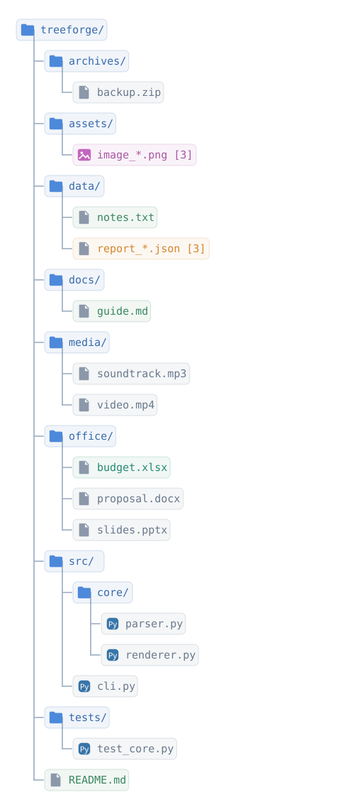
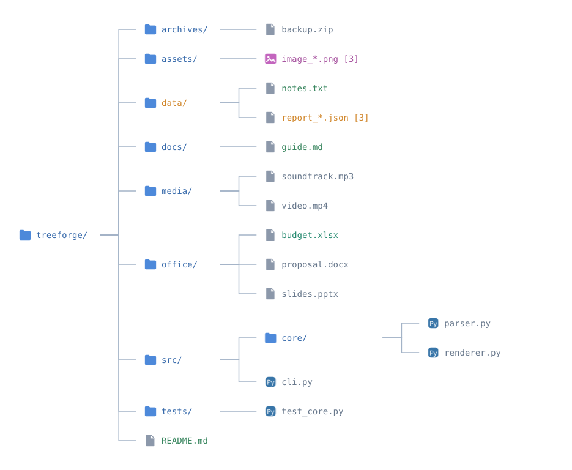
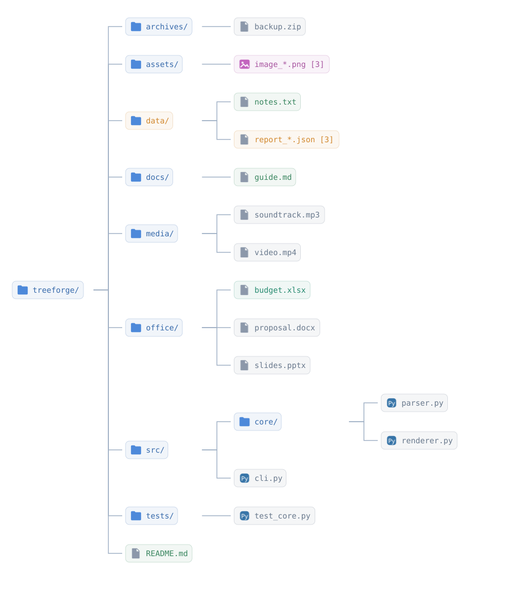

# Diagram gallery

All eight diagrams are generated by TreeForge from the **same directory structure** using `python devtools/generate_previews.py`.

## Default file-type icons

The default icons are automatically selected by file extension or category. These are the diagrams shown on the website home page and in the project README.

| Layout | Without boxes | With boxes |
| --- | --- | --- |
| **Vertical** |  |  |
| **Horizontal** |  |  |

## Custom SVG icons

You can replace the default icons using `--icons-dir ./icons`. These examples use the SVG files from the repository's `icons/` directory while retaining the exact same labels and layout settings.

| Layout | Without boxes | With boxes |
| --- | --- | --- |
| **Vertical** |  |  |
| **Horizontal** |  |  |

## Regenerating the gallery

```bash
python devtools/generate_previews.py
```

The four standard filenames always use default icons; the four files ending in `-custom.svg` use the custom icon directory.
