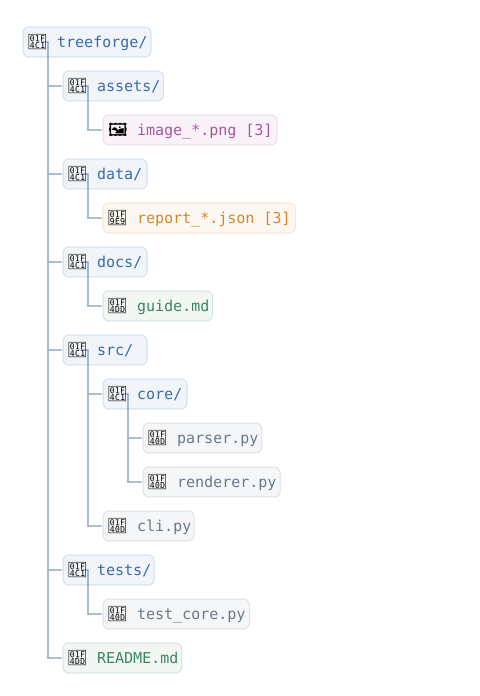
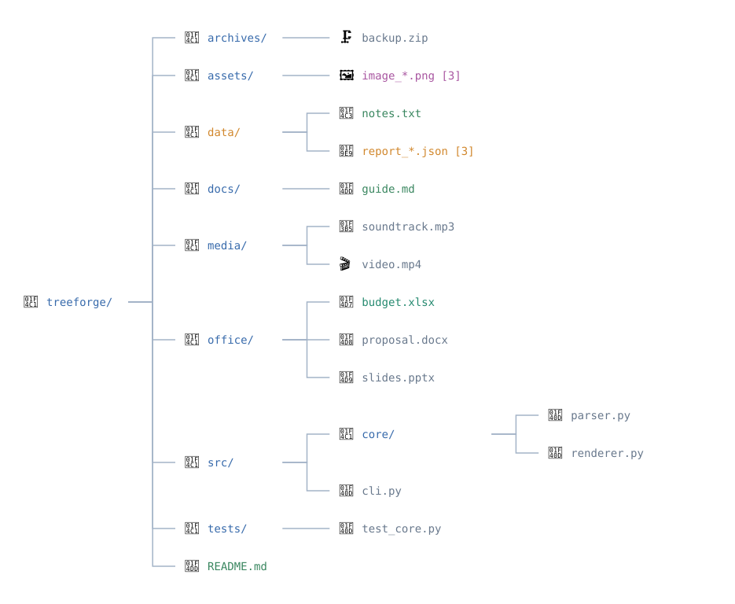
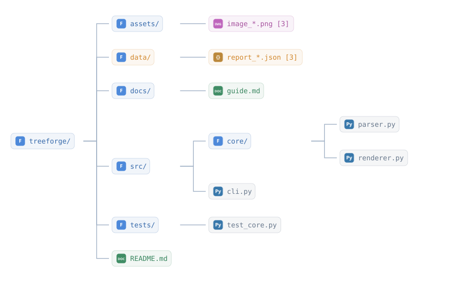

# Generated SVG examples

The images in this directory are produced from the same sample structure by the TreeForge native renderers.

| Orientation | Plain | Boxed |
| --- | --- | --- |
| Vertical |  |  |
| Horizontal |  |  |

Regenerate all four images from the repository root:

```bash
python devtools/generate_previews.py
```

The vertical plain SVG is TreeForge's default visual style.
