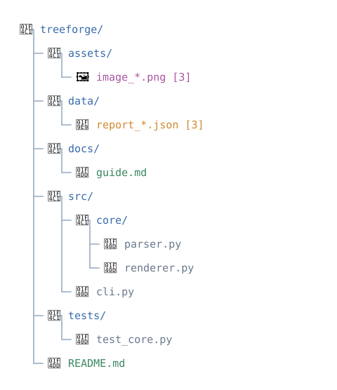
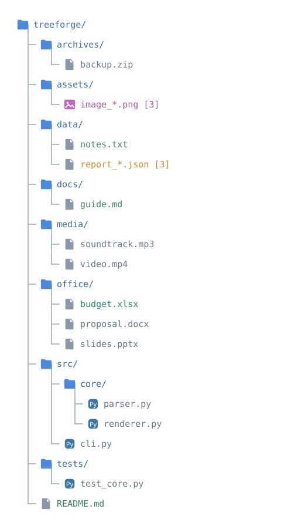

# Icons and customization

TreeForge uses expressive file-type symbols by default, including folder, images, Word, Excel, PowerPoint, JSON, ZIP, TXT, music, and video. The default vertical diagram is shown on the [home page](index.md).

## Compare icon styles

**Default icons:**



**Custom SVG icons using the same tree:**



The [full comparison gallery](examples/README.md) includes vertical and horizontal diagrams, with and without boxes, for both icon styles.

## Custom SVG directory

Use SVG files named after extensions, categories or general node types:

```bash
treeforge render . --icons-dir ./icons --output tree.svg
treeforge render . --icons-dir ./icons --layout horizontal --output horizontal.svg
```

Python API: `TreeConfig(icons_dir="./icons")`.

For each file, TreeForge checks the extension first (`json.svg`, `xlsx.svg`), then the category (`images.svg`, `documents.svg`), then `folder.svg` or `file.svg`. SVG files must be self-contained and no larger than 64 KiB; embedded scripts and external references are rejected.

Sample icon files are in the [repository icons directory](https://github.com/SergioGilBorras/treeforge/tree/main/icons).
